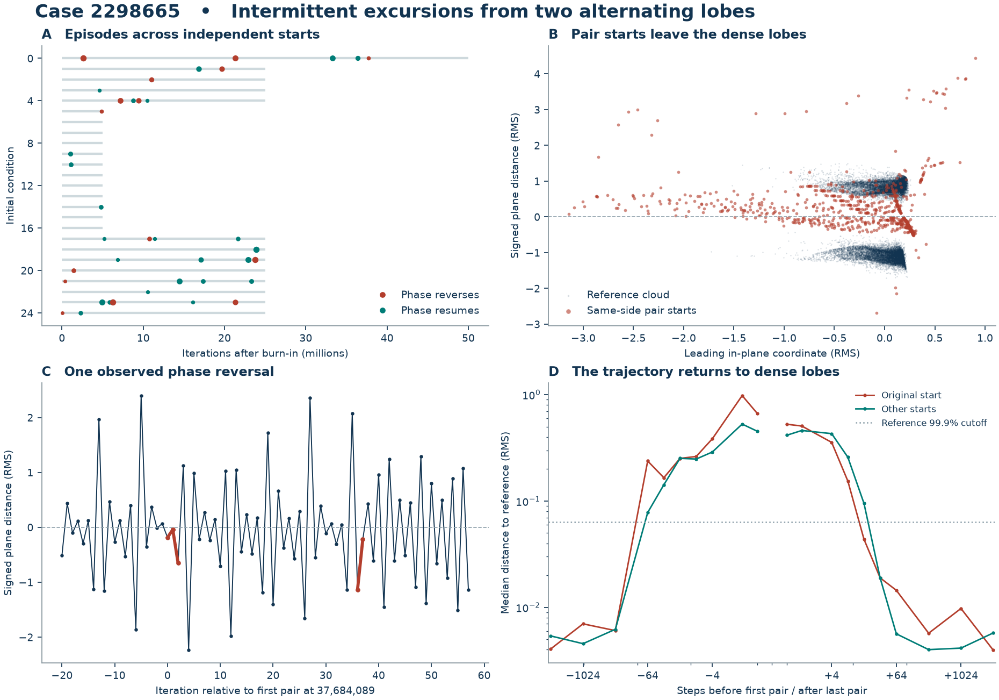

# Rare excursions from alternating lobes in Case 2298665

The deformed torus map alternates between two dense spatial lobes for long intervals. A replay of the original 50 million iterations reproduced all **791** consecutive same-halfspace pairs. They occur in **five** brief excursions. Three reverse the phase of later alternation and two resume the previous phase. Across 25 initial conditions and 410 million iterations, 39 excursions produced 3,067 same-side pairs and 15 net phase reversals.



Panel A marks one episode per symbol; symbol area increases with the logarithm of its number of same-side pairs. The horizontal lines give the observed time for each start. Panel B plots the left endpoints of all 791 original pairs over the archived 250,000-state cloud. Panel C joins successive observations in time, with the three same-side transitions of the smallest episode highlighted. Panel D shows median distances before the first and after the last violation of each episode. RMS is the root mean square radius about the reference cloud mean.

| Cohort | Observed iterations | Positive starts / starts | Same-side pairs | Episodes | Net phase reversals |
|---|---:|---:|---:|---:|---:|
| Original | 50,000,000 | 1/1 | 791 | 5 | 3 |
| Other archived starts | 160,000,000 | 8/16 | 397 | 12 | 5 |
| Eight new starts | 200,000,000 | 8/8 | 1,879 | 22 | 7 |

Here a positive start means at least one observed episode. The 12 shorter five-million-step archived runs contribute eight of the zero-episode traces. Sampling duration limits comparisons between cohorts.

## The five original excursions

The labeling plane was frozen before replay. An event index marks the left endpoint of a pair in the same open-positive or complementary halfspace. The first state after 100,000 discarded iterations has index zero. An episode merges successive event indices separated by at most 64 steps. A series of odd size reverses the even/odd phase by construction.

| First index | Last index | Span in left endpoints | Same-side pairs | Subsequent phase |
|---:|---:|---:|---:|---|
| 2,601,770 | 2,602,328 | 559 | 409 | Reversed |
| 21,336,227 | 21,336,496 | 270 | 213 | Reversed |
| 33,251,186 | 33,251,383 | 198 | 144 | Resumed |
| 36,380,766 | 36,380,800 | 35 | 22 | Resumed |
| 37,684,089 | 37,684,125 | 37 | 3 | Reversed |

Larger grouping gaps of 256 or 4,096 steps give the same five episodes. A 16-step gap splits two short interruptions, giving seven episodes. The original labels include 426 positive-positive pairs and 365 negative-negative pairs. [Full index of every pair](indices.json)

A plane trained on the first half of the frozen 250,000-point cloud classified the withheld half perfectly and reproduced exactly the same 791 indices over the full 50 million. Displacing the plane by up to 0.25 RMS or tilting it by ±7 degrees gave 773–1,001 pairs and 5–13 episodes. Every variant recovered all five original episodes within a 16-step neighborhood. Additional episodes depend on the classifier. [Plane sensitivity](cohort-00.json) · [Episode matches](episodes.json)

All 791 pair starts were at least 0.293 RMS from their closest sampled reference point in native three-dimensional space, with median 0.675 RMS. Ten thousand random states had median distance 0.00382 RMS. For each original episode the trajectory returned to the vicinity of the sampled lobes. Median distance from the first-half reference tree at 256 steps after the final pair was 0.00571 RMS. A separately fitted pair of oriented 3-D boxes, enlarged by 0.10 RMS on each face, also detected all five excursions. Eleven geometric departure groups exceeded that envelope on the primary trajectory. These finite trajectories support intermittent departures and returns within an observed regime. Distinct invariant basins and a particular bifurcation mechanism remain unestablished. [Geometric controls](envelopes.json)

## Empirical departure neighborhoods

Fit a nearest-neighbor reference to the first 125,000 XYZ points and calibrate a distance cutoff of 0.06361 RMS at the 99.9th percentile of distances in the second half. In each episode, locate the last run of 32 consecutive steps inside this cutoff preceding the first pair. The final state of this run lay in the negative lobe in all 39 episodes. The first pair followed 43–163 steps later with median 95. Twenty of 22 new-start departure locations fell within 0.10 RMS of one of the 17 earlier departure locations.

Using the 17 earlier locations as ball centers, test every state from the eight new initial conditions. A signal starts on first entry, with subsequent visits within 32 steps merged. At radius 0.01 RMS, **18 of 22** episode starts had a signal in the previous 200 steps. **18 of 124** signals were followed by an episode within that horizon. Radius 0.03 RMS covered 21 episodes at 828 signals; 0.06 RMS covered all 22 at 8,266 signals. Radius choices are exploratory. Nearby states can return to regular alternation without a sustained excursion.

A matched control drew 192 random 4,096-step blocks per new start, excluding blocks near known episodes. The same 32-inside/one-outside criterion produced 1,648 ordinary boundary crossings, including 1,401 on the negative side. At radius 0.01 RMS, 15/22 actual departure states landed inside the neighborhoods, compared with 4/1,401 ordinary negative-side crossing states. These are counts of correlated trajectory observations. [Departure coordinates](gates.json) · [Forward tests and controls](prospective.json)

## Numerical replay

Every complete trajectory was saved externally in native binary64 XYZ; the original repeated all archived 250,000 tail states at their saved binary32 precision. Every same-side pair has a binary64 window of 34 states from offsets −16 through +17 inclusive, preserving 16 neighbors on each side of the pair. Independent 256-bit MPFR dynamics restarted at the first exact binary64 state reproduce all 34 sign labels of every one of the 3,067 windows. For the primary 791 events, the maximum Euclidean coordinate difference at the two pair endpoints was 4.88e−11. Local restart agreement verifies the observed event geometry; it does not shadow the 50-million-step binary64 orbit globally. [Summary](summary.json) · [SHA-256 and portable paths](manifest.json) · [Original parameter record](../../extension/projection/cases/case-2298665.json) · [Original MPFR checks](mpfr-00.json)

Run from the repository root. Python dependencies are NumPy, SciPy, Numba, PyOpenCL and gmpy2. Matplotlib renders the diagnostic. The scripts consume the published extension case record, frozen plane and cloud.

```powershell
$s = 'research/shape_search_20261121/frontiers/projection'
$o = 'results/shape_search_20261121/frontiers/projection'
$e = 'results/shape_search_20261121/extension/projection'
$c = 'D:/Codex/chaos-attractor-cache/shape-search-20261121/frontiers/projection'
$z = 'D:/Codex/chaos-attractor-cache/shape-search-20261121/extension/projection/clouds/affine-2298665.npz'
$rec = "$e/cases/case-2298665.json"
$ref = "$e/parity-2298665.json"
python "$s/capture.py" --record $rec --cache $c --cohorts 0 --length 50000000
python "$s/capture.py" --record $rec --cache $c --cohorts (1..4) --length 25000000 --workers 4
python "$s/capture.py" --record $rec --cache $c --cohorts (5..16) --length 5000000 --workers 4
python "$s/capture.py" --record $rec --cache $c --cohorts (17..24) --length 25000000 --workers 8
python "$s/analyze.py" --record $rec --reference $ref --cloud $z --cache $c --output $o
python "$s/episodes.py" --record $rec --reference $ref --cloud $z --cache $c --output $o
python "$s/gates.py" --record $rec --cloud $z --cache $c --output $o
python "$s/envelopes.py" --cloud $z --cache $c --output $o
python "$s/prospective.py" --cloud $z --cache $c --output $o
python "$s/inventory.py" --cache $c --output $o
foreach ($file in (Get-ChildItem "$o/cohort-*.json")) {
    $row = Get-Content $file.FullName -Raw | ConvertFrom-Json
    if ($row.events) {
        $id = '{0:00}' -f $row.cohort
        python "$s/shadow.py" --record $rec --planes "$o/planes.json" --events "$c/event-windows-$id.npz" --out "$o/mpfr-$id.json"
    }
}
python "$s/plot.py" --cloud $z --cache $c --output $o --figure "$o/excursions.png"
```

For a clean reproduction, use fresh output and cache directories. The complete traces require approximately 9.84 GB of space.
