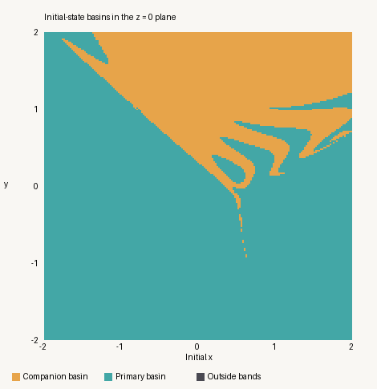

# Three positive numerical Lyapunov exponents

A targeted follow-up found **31 torus-posterior maps with positive growth in all three state-space directions**. Each retained case passes ten consecutive 500,000-step double-precision QR windows, at least 12 of 17 independent starts, and four independent 192-bit finite-shadow windows. The strongest measured third exponent is 0.0521 in Case 6802681. These are finite-time results for specific parameter sets. Twelve of the same maps additionally have rigorous compact subsystems of positive topological entropy. The subsystem certificates and the forward-orbit exponents answer different questions. [Case table including the exclusion](cases.csv) · [External contact-sheet index](../atlas.json) · [31 portable cloud records](manifest.json) · [Two-evaluator entropy audit](snapback/audit.json)

Published examples of three-positive spectra include a three-dimensional quadratic map and the three-dimensional Kaneko endomorphism. These precedents establish that the spectral pattern is known in other dynamical systems. The present records give reproducible parameters, sampled geometry and selected proofs for the posterior-reflection family. [Muni, 2024](https://arxiv.org/abs/2406.08317) · [Karatetskaia et al., 2025](https://rcd.ics.org.ru/S156035472502008X/)

| Long forward portrait | Sites | Five-million-step QR spectrum | Three-positive starts |
|---|---:|---|---:|
| [Layered triangular sail](case-6802681.json) | 5 | 0.280, 0.138, 0.052 | 17/17 |
| [Forked sail](case-6616162.json) | 4 | 0.265, 0.132, 0.021 | 17/17 |
| [Horned cup](case-6583985.json) | 7 | 0.229, 0.114, 0.026 | 17/17 |
| [Folded sail with a second basin](case-3014945.json) | 4 | 0.216, 0.106, 0.010 | 12/17 |

The leading shape differences are a forked outer edge, an upright cusp over a bowl and the presence of a sharply curved internal sheet. For the fork and the cup, the same canonical oblique view uses principal axes in decreasing variance order. Each axis has positive third central moment. Take the screen right vector as $(\sqrt{3}/2,0,1/2)$ and the up vector as $(-1/4,\sqrt{3}/2,\sqrt{3}/4)$ in that basis. The final PNGs in the campaign gallery use the original three coordinates. [Gallery study](../README.md)

## Search and numerical controls

| Parameter stage | New parameter sets | Deep GPU checks | Independent CPU rescreens | Five-million-step finalists | Retained |
|---|---:|---:|---:|---:|---:|
| Perturb single-torus parents | 393,216 | 1,152 | 16 | 14 | 13 |
| Perturb hard linked-torus parents | 393,216 | 1,152 | 16 | 0 | 0 |
| Perturb blended linked-torus parents | 393,216 | 1,152 | 16 | 0 | 0 |
| Evolve positive single-torus parents | 1,048,576 | 10,240 | 184 | 18 | 18 |

The first stage perturbs the 14 highest third-exponent parent configurations in the earlier CPU two-rate audit for each geometry. It varies the relaxation, temperature, tube radius, positions and shear of the site cloud. The second generation starts from 14 first-stage CPU survivors. Half the configurations are eligible to receive one to four extra sites. Screening by a short rate and quotas per number of added sites retains a range of geometries. The full study, including the earlier base survey, has 3,801,088 distinct binary32 operator/parameter configurations. An independent pass reconstructs the original parameter arrays and counts distinct 128-bit hashes. [Distinct-configuration count](../distinct-configurations.json) · [First-stage program](../../../../research/shape_search_20261121/projection/third_growth.py) · [Second-generation program](../../../../research/shape_search_20261121/projection/evolve_three.py)

First-stage short runs discard 1,024 updates and measure four 384-step windows. The GPU transports two directions and obtains the third stretch by projecting the advanced third normal onto the new orthonormal frame normal. The deeper GPU stage discards 32,768 updates and measures four 8,192-step windows. CPU rescreens use two-pass modified Gram–Schmidt on the analytic Jacobian, discard 100,000 steps and measure four 65,536-step windows. The second generation retained 182 of 184 CPU rescreens with all three rates above 0.005 in every window. Five insertion-stratum winners and 13 cases chosen for spatial diversity received long tests. The selection emphasizes the upper tail and cannot estimate prevalence in the unfiltered parameter distribution. [Single-torus audit](../three-rate-single.json) · [Hard-linked audit](../three-rate-linked.json) · [Blended audit](../three-rate-smooth.json) · [Evolved audit](../three-rate-evolved.json) · [All evolved CPU windows](evolved-audit/)

Long runs discard 100,000 updates and store the final 250,000 consecutive native states as binary32 after double-precision evolution. The three-positive criterion requires all ten primary third-rate windows above 0.001, no detected period in the ordinary primary checks, a majority of starts satisfying the same three-rate criterion over four 16,384-step windows, and a third exponent above 0.001 in every available MPFR window. Twenty-three retained cases exceed 0.015 in every primary third-rate window. Twenty-four retain three positive directions for 17/17 starts. In Case 3092055 only two of the 17 starts pass, its primary minimum third rate is 0.00096, and one 192-bit window gives −0.00043. [32 forward records and controls](cases.csv) · [Excluded case](case-3092055.json)

Extended runs cover 100 million measured updates each for Forked sail, Horned cup, Layered triangular sail, and both observed basins of Case 3014945. Across 20 windows of five million updates the smallest third rate is 0.02036 for Forked sail, 0.02557 for Horned cup and 0.05153 for Layered triangular sail, rounded to five decimal places. The one-positive companion retains the mean spectrum (0.13842, −0.15846, −1.21679). [Extended QR windows](extended/)

The MPFR check evolves four independently evaluated trajectories. Every four updates, it orthogonalizes the three finite displacement vectors twice and rescales them to $2^{-\lfloor b/3\rfloor}$ at $b$ bits. The 192-bit runs discard 8,192 steps and measure four windows of 8,192. Selected 256-bit runs discard 16,384 and measure four windows of 16,384. The MPFR calculation uses the original nested reflectors and finite perturbations. [Precision records](precision/) · [Finite-shadow implementation](../../../../research/shape_search_20261121/projection/mpfr_three.py)

A larger cohort tested 1,024 fresh uniform starts per map. Of 31,744 GPU starts, 30,320 have all three exponents above 0.001 in every 8,192-step window after a 32,768-step discard. A random matched subset gives 967/992 positive under longer binary64 QR windows. The paired counts are 939 both positive, 28 CPU only, zero GPU only and 25 neither. Forked sail, Horned cup and Layered triangular sail each pass 1,024/1,024 on the GPU and 32/32 in the matched CPU check. The 5×5 double-precision radius–temperature neighborhoods retain all three positive in 662/775 trials. Eleven cases pass all 25 neighbors. [Expanded cohort](large-cohort.json) · [Parameter neighborhoods](neighborhood/)

## Shape controls

A spatial control preserves each individual PCA coordinate distribution and its time ordering. It independently rotates the second and third coordinate time series by large circular offsets, then compares the joint histogram with the observed simultaneous positions. In both temporal halves of all 31 clouds, the observed total correlation exceeds every shifted control for 8, 16 and 24 equiprobable bins per axis. For Forked sail at 16 bins, the observed values are 0.570 and 0.569 nats. The corresponding largest shifted controls are 0.017 and 0.017. This measures simultaneous three-coordinate structure at those resolutions. [All scales, halves and control extrema](shape-dependence.json)

Alpha-complex persistence was also compared with the 108 archived regimes using the same truncation allowance and temporal-half controls as the base survey. None of these 31 clouds cleared the criterion of a lower distance to *every* reference above both within-case bounds. [Archive comparison](topology-reference.json)

## Two chaotic-looking basins at identical parameters

Case 3014945 samples two spatially separated regimes. The primary orbit has spectrum approximately $(0.216,0.106,0.010)$ and the other orbit has $(0.138,-0.158,-1.217)$ over five million updates each. Five of the original 17 starts reach the companion, and twelve reach the primary. Among the nearest distances from every seventh state of either cloud to the entire other cloud, both medians exceed 1.4 pooled RMS radii. The within-portrait medians between temporal halves are below 0.004. [Companion parameters, starting state and distances](companions/companion-3014945.json)



The GPU tested 32,768 pseudorandom initial states uniformly distributed on $[-2,2]^3$ and an independent 193×193 grid on the $z=0$ plane. Of the volume samples, 26,811 end in the primary cloud's sampled coordinate band and 5,957 in the companion's band. All 240 randomly selected GPU volume assignments match longer independent binary64 replays. The terminal classifier uses all of the last 128 x-coordinates. Binary32 and longer binary64 classify the signs in 137/240 of those starts identically under the fixed finite-window thresholds. The weak third exponent accounts for an unresolved class in the short run. The data retain these classifications separately. [Counts, thresholds and 240 pointwise cross-checks](basins-3014945.json)

## Certified subsystems and periodic companions

The interval method supplies a compact invariant subsystem with positive topological entropy in twelve of these parameter sets. Each packet verifies a periodically repelling base and two disjoint inverse branches into the same chart. The original return lengths range from 148 to 406. The two interval implementations check every source box and revisit the same full-dimensional root. For all twelve cases each inverse branch has a verified full-return Lipschitz constant below 0.0151 in the chart norm. Each forward return on its invariant Cantor subsystem is therefore conjugate to the full one-sided binary shift. Some packets use multiple primitive periods for the locally contracting inverse. [Proof argument](../snapback/README.md) · [Twelve frozen packets and numerical proposals](snapback/) · [Audit](snapback/audit.json)

In Case 3231505, the entropy bound is $\log(2)/188$ and a separate least-period-four attracting cycle is enclosed. Case 3275794 has the bound $\log(2)/220$ and a separate attracting period-two cycle. Each point of the sink cycle is interval-separated from the common entropy chart. An orbit in its full invariant subsystem must return to that chart within the certified return time, so neither periodic sink belongs to the subsystem. Both maps therefore support rigorously distinct invariant dynamics. The entropy subsystems in Cases 3231505 and 6802681 also pass the two interval implementations with relaxation values varying over explicitly enclosed parameter bands. [Uniform relaxation-band checks](bands/) [First sink](sinks/cycles-3231505.json) · [Second sink](sinks/cycles-3275794.json) · [Local-cycle and sink audit](certificate-audit.json)

## Reproduce

From the repository root, use the environment described in the [main report](../README.md).

```powershell
$src = 'research/shape_search_20261121/projection'
$res = 'results/shape_search_20261121/projection'
$cache = 'D:/Codex/chaos-attractor-cache/shape-search-20261121/projection'
python "$src/reproduce.py" --record "$res/three/case-6802681.json" --out "$cache/replay-6802681.npz" --reference "$cache/final/case-6802681-points.npz"
python "$src/mpfr_three.py" --source "$res/three" --out "$cache/replay-mpfr" --cases 6802681
python "$src/audit_entropy.py" --source "$res/three"
python "$src/third_growth.py" --source $res --out "$cache/replay-three-rate" --batches 96
python "$src/third_rescreen.py" --survey "$cache/replay-three-rate" --out "$cache/replay-three-deep" --records "$cache/replay-three-records"
python "$src/evolve_three.py" --deep "$cache/replay-three-deep/deep-single.npz" --records "$cache/replay-three-records/three-rate-single.json" --out "$cache/replay-three-evolved"
python "$src/evolved_rescreen.py" --survey "$cache/replay-three-evolved" --out "$cache/replay-three-deep" --measurements "$cache/replay-three-records"
```

The primary and companion JSON records can each be passed directly to the portrait replay program. The numerical proof proposals are optional inputs to interval generation. Frozen entropy packets are rechecked directly.
