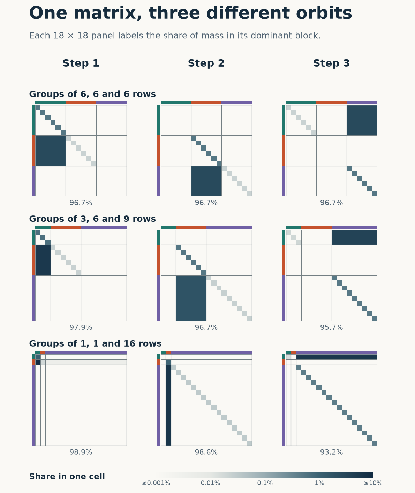

# A balanced matrix with 128,878,020 attracting three-cycles

The 18 × 18 input already has the requested row and column sums. Start the fixed-rate Sinkhorn iteration from different scalings and at least **128,878,020** other attractors are available. On each orbit, three groups of rows take turns carrying the greatest mass per row. Removing row and column names still leaves **46 distinct group-size schedules**.



The three panels in each row are successive iterates. At the fourth step the first matrix returns. All cell shares use the same logarithmic color scale.

## The iteration

Set $`K_N=0.99I+0.01\mathbf1\mathbf1^\top/N`$, target all row and column sums to one, and fix $`\omega=7/4`$. Starting from $`M=\mathrm{diag}(u)K_N\mathrm{diag}(v)`$ with positive factors, apply these two operations once per step.

1. Divide each row by its current sum raised to $`\omega`$.
2. Divide each column of the result by its current sum raised to $`\omega`$.

The balanced solution is also locally attracting. For every $`3\le N\le18`$, each cyclically ordered partition of the labeled rows into three nonempty groups gives a distinct attracting three-cycle. There are $`(3^N-3\,2^N+3)/3`$ such partitions. Other periods and attractors are outside this count.

| Matrix size | 4 | 5 | 6 | 7 | 8 | 12 | 18 |
|---|---:|---:|---:|---:|---:|---:|---:|
| Certified three-cycles, at least | 12 | 50 | 180 | 602 | 1,932 | 173,052 | 128,878,020 |

**Break the symmetry.** For $`N=6`$ subtract $`L/300000`$ from $`K_6`$, where $`L`$ is the graph Laplacian of a path with consecutive edge weights 1, 2, 3, 4, 5. This preserves the marginals and removes every nonidentity simultaneous permutation symmetry. All **180** cycles still attract. A full ten-dimensional interval check distinguishes them by the sets of rows exceeding half the largest row sum at each step. [Certificates and parameters](cycles.json)

## Counting the cycles and testing stability

With group sizes $`m_i`$ and proportions $`p_i=m_i/N`$, let $`D_i(v)=99v_i+\sum_jp_jv_j`$. The row correction uses $`1/D_i(v)`$ up to a common factor. The column correction uses the same formula with the updated $`u^+`$. The dynamics with synchronized groups therefore require four log-ratios, independently of $`N`$. A Krawczyk test encloses a point of the third return. Strict inequalities for the actual row sums distinguish its three phases.

Linearization splits into the four group coordinates and $`m_i-1`$ copies of a two-dimensional block for zero-sum perturbations within group $`i`$. Write $`r=1-\omega`$, $`a=99v_i/D_i(v)`$ and $`b=99u_i^+/D_i(u^+)`$. One step has block

```math
B_i=\begin{pmatrix}r&-\omega a\\-\omega br&r+\omega^2 ab\end{pmatrix}.
```

The checker multiplies these blocks in time order and applies the Schur test to each product and to the four-dimensional collective return. Scaling a matrix by $`c`$ scales its next iterate by $`c^{r^2}`$. Consequently each periodic solution in log-ratios gives a unique periodic scaled matrix with a contracting overall scale. At the balanced solution the same block has $`a=b=0.99`$ and both eigenvalues lie inside the unit disk.

At equal group sizes the collective return has spectral radius below 0.4443 and every splitting block below 0.7391. The implicit function theorem and strict inequalities preserve this cycle, its rotating heavy groups and its stability throughout an open neighborhood of equal proportions. A uniformly random three-color labeling has proportions in this neighborhood with probability tending to one. Only three cyclic shifts encode the same unlabeled-in-time orbit. Thus the number of labeled attractors is **at least $`(1-o(1))3^{N-1}`$ as $`N\to\infty`$**. Even after arbitrary site relabeling, this neighborhood contains order $`N^2`$ different cyclic group-size profiles.

Very unequal groups can break. With group sizes $`(1,1,270)`$, the largest group's leading splitting multiplier lies in $`(0.9999248,0.9999249)`$. With $`(1,1,271)`$ it lies in $`(1.0000435,1.0000436)`$, producing **270 expanding directions** while the collective cycle still attracts within the synchronized subspace. The [earlier three-row example](../sinkhorn-route/) also loses stability when its rows are cloned.

Fixed overrelaxation and its convergence limits were studied by [Thibault et al.](https://arxiv.org/html/1711.01851v2) and [Lehmann et al.](https://arxiv.org/abs/2012.12562). Exponential counts produced by permutations of clusters also occur in [pulse-coupled oscillators](https://arxiv.org/abs/cond-mat/0202438). Here the certificates concern attracting cycles of the fixed-rate matrix-scaling map.

Run from the repository root with python-flint 0.9.0. The figure also uses NumPy and Matplotlib and checks the three displayed returns directly in matrix coordinates.

```bash
python research/sinkhorn_choreography.py
python research/sinkhorn_choreography_plate.py
```
