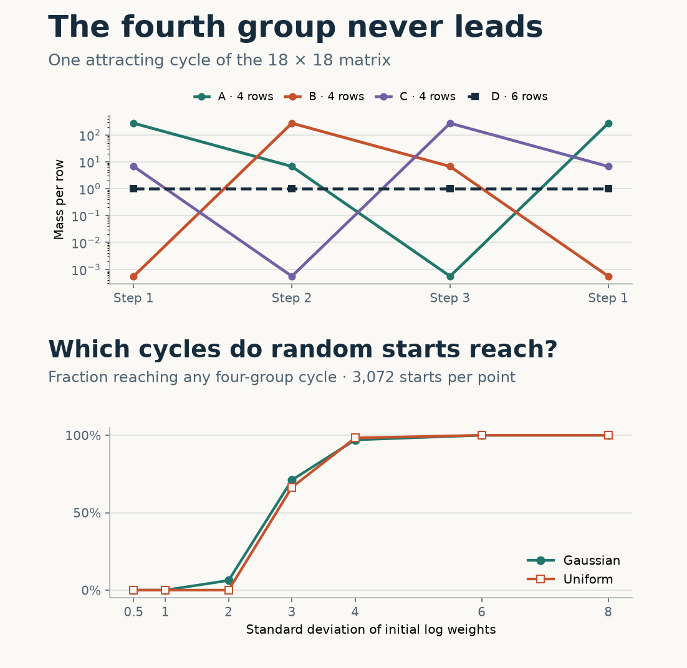

# The rows that never take the lead

The same $`18\times18`$ matrix has at least **22,519,333,900 attracting three-cycles**. The earlier census found 128,878,020 cycles where every row takes its turn. Another **22,390,455,880** have a fourth group of rows that never leads. In the example below, all six rows in that group have exactly the requested sum of one throughout the cycle.



**Which cycles did we actually see?** Among 43,008 log-random initial scalings, every start reached the balanced matrix or matched a four-group cycle. None matched the three-group family. At log standard deviation 3, four groups appeared in 2,184 of 3,072 Gaussian starts and 2,039 of 3,072 uniform starts. Every start at standard deviations 6 and 8 reached four groups. These frequencies describe the two sampled distributions. [All per-seed counts](visibility.json)

Each entry of $`\log u`$ and $`\log v`$ was drawn independently from $`N(0,\sigma^2)`$ or from $`[-\sqrt3\sigma,\sqrt3\sigma]`$ uniformly. Three seeds produced 1,024 configurations apiece per distribution, reused across amplitudes. After 450 and 900 iterations, the classifications agreed for every start. Each match uses all row and column log weights over three consecutive steps, with a common permutation of both site labels and a maximum absolute error below $`10^{-7}`$. The gauge sets the mean row log to zero and preserves the physical scale. The classifier also recovered all 46 three-group and 230 four-group profiles from independently perturbed, permuted examples.

<details>
<summary>What distinguishes the cycles, and why six rows stay exactly balanced</summary>

Use the [same system and parameters](README.md#the-iteration), $`K_N=0.99I+0.01\mathbf1\mathbf1^\top/N`$ and $`\omega=7/4`$. The three sets of rows attaining the highest individual row sum in successive phases are nonempty and disjoint. Their nonempty complement is the fourth group. Thus the matrices themselves identify the four groups, up to shifting the starting phase. Each surjection of 18 labels onto four roles gives one of these cycles, with three assignments per orbit. The count is $`(4^{18}-4\cdot3^{18}+6\cdot2^{18}-4)/3`$.

For each of the 230 cyclically distinct size profiles, 416-bit interval arithmetic certifies a root of the third return and the strict leader at each phase. The Jacobian has one six-dimensional collective block and $`m_i-1`$ copies of each group's two-dimensional splitting block, derived [here](README.md). All return blocks pass the Schur test. At equal proportions the collective spectral radius is below 0.4406 and every splitting radius below 0.7145. Continuity and the implicit function theorem give a neighborhood of equal proportions with all four roles. Random four-color counts concentrate there as $`N`$ grows, giving at least $`(1-o(1))4^N/3`$ labeled attracting cycles. [Seeds, multiplier bounds and exact symmetry check](visibility.certificates.json)

For group sizes $`(4,4,4,6)`$, let $`H`$ divide rows by their sums to the power $`\omega`$, then transpose. Two such half-steps give one full iteration. A second Krawczyk enclosure proves $`H`$ acts as a cyclic permutation of the first three groups on this orbit. Its root lies inside the unique third-return root enclosure. The proportionality in ratio coordinates lifts to equality of matrices because the periodic overall scale is unique. For a spectator row $`i`$, its diagonal entry is therefore unchanged by $`H`$. Since $`H(M)_{ii}=M_{ii}/(\sum_jM_{ij})^\omega`$ and $`M_{ii}>0`$, the row sum equals one. Column $`i`$ of $`H(M)`$ is the rescaled original row $`i`$, so its sum also equals one. The permutation fixes $`i`$, giving the same column sum in $`M`$.

</details>

```bash
python research/sinkhorn_visibility.py --certificates-only
python research/sinkhorn_visibility.py
```
