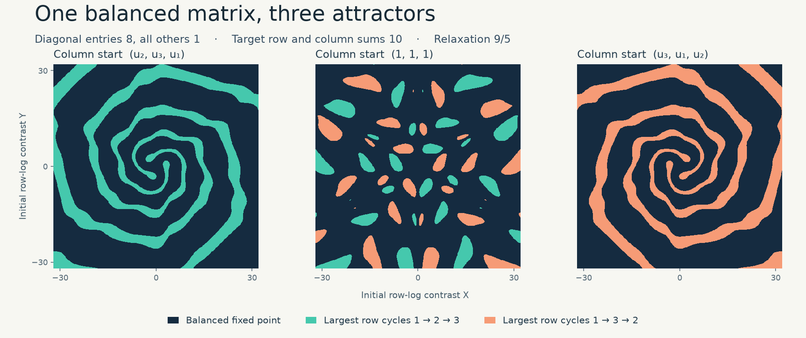

# Two rotating cycles in matrix scaling

The input matrix is already balanced. At fixed relaxation $`9/5`$ the overrelaxed Sinkhorn iteration has at least **three attractors** in anchored scaling coordinates. The balanced solution is one. On each of the two period-three cycles a single row carries **69.28%** of the total mass. The heavy row moves forward on one cycle and backward on the other.



Each pixel starts with a different row scaling $`u`$. The panels change only the starting column scaling. The cycles and their attraction are certified by interval arithmetic. The colors are numerical outcomes after at most 400 iterations. All 789,507 starts reached a known phase within $`10^{-8}`$. [Grid counts](grid.json) · [Cycle and fold certificates](symmetric.json)

**Try one point.** Start the row weights at (4, 64, 1) and the column weights at (64, 1, 4). After 75 updates they enter a certified trapping box for the forward cycle. Swapping labels 2 and 3 in both vectors gives the reverse cycle.

## System

```math
K=\begin{pmatrix}8&1&1\\1&8&1\\1&1&8\end{pmatrix},\quad a=b=(10,10,10),\quad \omega=9/5.
```

```math
u^+=u^{1-\omega}\circ(a/(Kv))^\omega,\qquad
v^+=v^{1-\omega}\circ(b/(K^\top u^+))^\omega.
```

Powers and division are componentwise. The heavy row is measured in $`\mathrm{diag}(u)K\mathrm{diag}(v)`$. The axes set $`\log u=X(1,-1,0)/\sqrt{2}+Y(1,1,-2)/\sqrt{6}`$. Column starts appear above the panels. [Anchored equations and archive](../../docs/sinkhorn-screen.md#published-map-and-coordinates)

## What the proof checks

- For each period-three point a Krawczyk inclusion encloses a root of the third return minus the identity. Disjoint phases give least period three. A Schur test bounds every third-return multiplier in modulus by 0.6478. Swapping two row and column labels reverses the heavy-row order, giving a distinct orbit. The fixed point has all multiplier moduli below 0.801.
- The rotating solutions have a local fold at $`1.76514850<\omega<1.76514852`$. Two branches exist locally on the larger-relaxation side. In anchored row logs $`x=(\log(u_2/u_1),\log(u_3/u_1))`$, set $`P(x_1,x_2)=(x_2-x_1,-x_1)`$. With $`F`$ the anchored log row correction, a rotating solution satisfies $`G=\omega F(x)+(1-\omega)P^2x-Px=0`$. The checker encloses a root of $`(G,\det D_xG)=0`$ and verifies the rank, transversality and nonzero quadratic term.
- The same interval test certifies **all 21** nonconstant recurrences in the archived matrix screen. Their least periods are 3, 5, 7, 8, 15, 27 and 33. Each is locally attracting. [Per-input certificates](certificates.json)
- The archived 4 × 4 matrix with persistent growth (Case 64, relaxation 1.99) has a **saddle three-cycle**. At each phase the one-step Jacobian has every eigenvalue inside the unit disk. Their ordered product has three expanding eigenvalues, the largest between 5.143 and 5.144. Whether the long irregular trajectory shadows this orbit remains open. [Six disjoint multiplier enclosures](expanding-return.json)

Fixed-relaxation nonconvergence was already observed, and sufficient global and local convergence ranges are known. The rotating cycles here lie outside the sufficient global range. There is also an interactive example of ordinary Sinkhorn contraction on this same symmetric family of kernels. [Thibault et al., §4.1](https://arxiv.org/html/1711.01851v2) · [Lehmann et al.](https://arxiv.org/abs/2012.12562) · [Peyré's simplex visualization](https://www.gpeyre.com/blog/2026/07/30/perron-frobenius-and-sinkhorn/)

```bash
python research/sinkhorn_route.py
python research/sinkhorn_route_basins.py --check
```

The first command uses python-flint 0.9.0 with 640-bit precision. The second uses NumPy, Numba and Matplotlib. It checks an independent probability-domain update, the reflection symmetry of every sampled pixel, and 49,923 common grid points at tolerance $`10^{-11}`$ and 800 steps.
