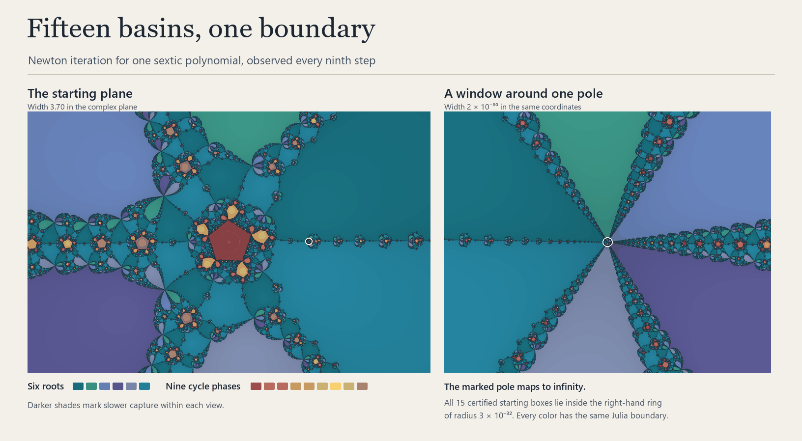

# Fifteen basins on one Newton boundary

Newton iteration for a single sextic reaches six roots and one cycle of period nine. Sampling every ninth step distinguishes all nine phases, giving **fifteen basins with the same boundary**. In the disk marked below, of radius $`3\times10^{-32}`$, interval arithmetic locates an open set for every outcome. [Interval certificate](certificate.json)

[Map and coefficient](#the-map-and-its-outcomes) · [Proof at the pole](#fifteen-choices-at-one-pole) · [Zoom and phase shifts](#a-zoom-that-permutes-nine-colors) · [Search](#search-and-historical-context) · [Reproduce](#reproduction)



<!-- drawing-date -->
*Drawn: **2026-11-22**.*
<!-- /drawing-date -->

**Reading the figure.** The left panel spans $`[-1.85,1.85]\times[-1.20,1.20]`$. The right panel zooms to width $`2\times10^{-30}`$ at the marked pole. Its central ring encloses the fifteen certified sets. Cool colors mark roots, warm colors mark cycle phases, and darker shades indicate slower capture within each panel.

## The map and its outcomes

```math
p_a(z)=z^6-az+a,\qquad N_a(z)=z-\frac{p_a(z)}{p_a'(z)}=\frac{5z^6-a}{6z^5-a},\qquad G=N_a^9.
```

Case 6902 uses $`a\simeq1.277961358032196+0.074550069827001i`$. Exactly, $`a`$ is the unique zero of $`N_a^9(0)`$ within $`10^{-142}`$ of the dyadic center in the certificate. The nine orbit points have pairwise separation greater than 0.003642. The six roots have pairwise separation greater than 0.6017.

Each simple root of $`p_a`$ is a superattracting fixed point of $`N_a`$. The remaining critical point, zero, has multiplicity four and belongs to the superattracting nine-cycle. These exhaust all ten critical points counted with multiplicity, so the map is hyperbolic. Under $`G=N_a^9`$, the nine cycle points are distinct attracting fixed points alongside the six roots.

**Why the boundaries coincide.** Each fixed point of $`G`$ has a full basin $`B_j`$, an open, completely invariant union of Fatou components. If a neighborhood of a Julia point missed $`B_j`$, all its forward images would omit the whole basin, including three distinct values. Montel's theorem would make the iterates normal there, contrary to the definition of a Julia point. Each Fatou component lies in a basin, so its interior contains no basin-boundary points. Thus $`\partial B_j=J(G)=J(N_a)`$ for every full basin. This is the Wada property. [Milnor, *Dynamics in One Complex Variable*](https://arxiv.org/abs/math/9201272)

## Fifteen choices at one pole

The marked pole $`\xi=(a/6)^{1/5}\simeq0.734161053096716+0.008556170353017i`$ (principal branch) maps to the repelling fixed point at infinity. A 656-bit Arb calculation certifies contraction for the parameter and root equations and for the capture disks around the roots and zero. On the zero-centered disk of radius $`10^{-7}`$, the derivative of $`N_a^9`$ has modulus below $`7.18\times10^{-24}`$.

Inverse branches give fifteen starting boxes of coordinate half-width $`10^{-101}`$ inside $`|z-\xi|\lt 3\times10^{-32}`$. Interval propagation sends each entire box into its assigned capture disk after 386–394 Newton steps. A second implementation with 160-digit `Decimal` arithmetic, using the polynomial and derivative directly, agrees on every center and capture time. [Witness boxes](certificate.json) · [Independent replay](independent-decimal.json)

### A zoom that permutes nine colors

Near infinity, in the coordinate $`1/z`$, the Newton map has multiplier $`6/5`$. Let $`L`$ be its local inverse branch fixing infinity. At $`\xi`$ the Newton map has a simple pole, so its restriction $`H`$ there is locally invertible on the sphere. The local change of coordinates

```math
T=H^{-1}\circ L\circ H,\qquad T(\xi)=\xi,\quad T'(\xi)=5/6,\qquad N_a^2\circ T=N_a
```

preserves the six root labels and moves a point in phase $`j`$ into phase $`j-1\pmod9`$. Applying it nine times restores all colors. In the original plane, simple Euclidean contraction by $`5/6`$ is its first-order approximation.

At half-widths $`10^{-1},10^{-3},10^{-8},10^{-30}`$, we compared 204 offsets with copies shrunk by $`5/6`$. The predicted color permutation held for 136, 186, 204 and 204 pairs, respectively. At the finest scale, all 204 shrunken starts took exactly one more Newton step to reach their capture sets. The sample used 144 uniformly spaced pixel centers and four per outcome. [Paired interval results](scale-control.json)

## Independent geometric checks

**Forward iteration.** The left and right panels classify 1,420,800 and 800,000 starts, respectively. At microscopic scale the first step uses the principal part of the Laurent expansion at the pole. Above modulus $`10^5`$ the iteration uses $`(5/6)z`$, then switches to the rational formula. Direct interval iteration matched the color and capture time on all 299 checked pixel centers, drawn from random pixels and representatives of every outcome. [Forward grid](inverse-check.json) · [Microscopic grid](microscopic-check.json)

**Inverse iteration.** For each $`w`$, solve $`5z^6-6wz^5+a(w-1)=0`$ for its six preimages. Starting at the five finite poles gives 1,399,680 points that first reach infinity at depth eight. Retaining one point per occupied spherical voxel of side 0.004 gives 99,423 representatives through depth 23. These approximate the Julia set because the nonexceptional point at infinity has a dense backward orbit in it. For $`z=x+iy`$ the spherical coordinates are $`(2x,2y,x^2+y^2-1)/(1+x^2+y^2)`$.

Inside the left panel's one-pixel margin, all 67,760 retained inverse points lie within two pixels of a forward color boundary. In the other direction, 83.68% of 160,000 sampled boundary pixels lie within two pixels of a retained inverse point (median 0.834, 99th percentile 22.62 pixels). The unstratified depth-eight sample covers 53.22% at that tolerance. [Inverse comparison](inverse-check.json) · [Depth-23 control](stratified-inverse.json)

## Search and historical context

For each degree from 4 to 6 and period from 3 to 9, 8,192 scrambled Sobol starts seeded coefficient solves. Of 172,032 starts, 114,778 converged numerically. We grouped conjugate coefficients by rounding to six decimals and inspected at most 50 clusters per degree/period pair. Of 801 clusters checked, 54 passed the spatial and visibility filters. We chose Case 6902 for its nine visible phase regions, then certified its exact period. [Search counts and array hashes](manifest.json)

Campbell and Collins proved that this family supports any prescribed period for every degree at least three, using $`a=(d-1)c^d`$. Here the particular complex coefficient links the common boundary to fifteen microscopic witnesses and a local zoom that permutes nine colors. [Campbell and Collins, *Specifying attracting cycles for Newton maps of polynomials*](https://arxiv.org/abs/1208.5687)

## Reproduction

Run from the repository root. The certificate replay uses the checked-in JSON. The remaining commands regenerate the search, arrays, checks and figure. The recorded environment used Python 3.12.14, NumPy 2.5.4, SciPy 1.18.1, Numba 0.68.0, Pillow 13.0.0 and python-flint 0.9.0.

```powershell
$src = 'research/wow_search_20261122/boundary'
$out = 'results/wow_search_20261122/boundary'
$env:WOW_BOUNDARY_CACHE = 'D:/Codex/chaos-attractor-cache/wow-search-20261122/boundary'
$env:NUMBA_CACHE_DIR = "$env:WOW_BOUNDARY_CACHE/numba"
$env:OPENBLAS_NUM_THREADS = '1'
New-Item -ItemType Directory -Force $env:WOW_BOUNDARY_CACHE | Out-Null
python "$src/certificate.py" --verify "$out/certificate.json"
python "$src/search.py" --levels 13 --max-seen 50
python "$src/inverse.py" --depth 8
python "$src/stratified.py"
python "$src/certificate.py"
python "$src/decimal_control.py"
python "$src/microscope.py" --width 1000 --height 800
python "$src/scale_control.py"
python "$src/figure.py"
python "$src/receipt.py"
```

The catalog cloud `case-6902-stratified-inverse-sphere.npz` contains `points[99423,3]`, `plane[99423,2]` and `first_infinity_depth[99423]`. Separate archives retain every depth-eight point in native and sphere coordinates. The label grids include capture times. Raw paths in the manifest are relative to the parent of `WOW_BOUNDARY_CACHE`. Branch ordering and image fonts can vary by platform. [Source](../../../research/wow_search_20261122/boundary) · [Data manifest](manifest.json)
