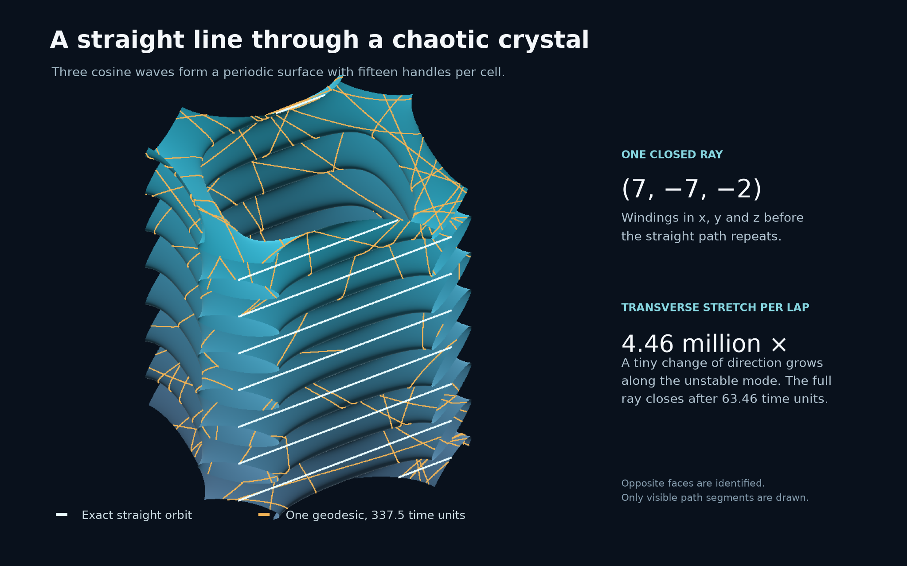

# An exactly straight orbit on a fifteen-handle chaotic attractor

A straight line on a periodic three-dimensional lattice closes after winding seven times in x, seven times backwards in y, and twice backwards in z. It lies on a uniformly hyperbolic attractor. Its unstable transverse multiplier is strictly between **4,450,000 and 4,470,000** per lap. In two independent numerical integrations, rotating its initial velocity by one millionth of a radian sends the particle 0.2 distance units away from the straight ray after 47.454 time units, before the ray completes one lap.



<!-- drawing-date -->
*Drawn: **2026-11-22**.*
<!-- /drawing-date -->

## Three waves and a unit-speed flow

Coordinates q = (x,y,z) are angles modulo 2π. The crystal in the figure has n = 7 and k = 3/8. Let g and H be the ordinary gradient and Hessian of F. A particle's tangential velocity is u. The following smooth equations define the flow on a neighborhood of its attracting set.

```math
\begin{aligned}
 F(q)&=\cos x+\cos y+k\cos(x-y+nz),\qquad
 u=v-\frac{g\cdot v}{|g|^2}g,\\
 \dot q&=v,\qquad
 \dot v=-\frac{v^T H v+3g\cdot v+2F}{|g|^2}g+(1-|u|^2)u .
\end{aligned}
```

The attracting set consists of the unit tangent vectors to F = 0. On this set normal acceleration supplies the constraint, tangential acceleration vanishes, and the particle follows a unit-speed geodesic. The geometric surface in the figure is its projection into position space. The state also includes velocity. The feedback equation gives F″ + 3F′ + 2F = 0 exactly. On F = F′ = 0 the speed approaches one for all nearby positive initial speeds. More explicitly, for S = |v|² near the target, S′ = 2(1−S)S + O(|F| + |F′|), uniformly on a compact neighborhood with |g| bounded below. The decaying forcing and the stable scalar equilibrium S = 1 give local attraction. The model only needs the neighborhood where g is nonzero.

## Why the surface has fifteen handles

Use w = x − y + nz. The map (x,y,z) ↦ (x,y,w) is an n-fold covering of the flat torus. Project the basic level surface to the (x,y) torus. For 0 < k < 2 the allowed domain |cos x + cos y| ≤ k is a torus with two open disks removed. The excluded regions are the caps around the unique maximum and minimum, bounded by regular level circles above and below the saddle value zero. The basic surface glues two copies of this punctured torus along both circles. It is connected and has Euler characteristic −4.

There is a closed curve on the basic surface with x = π/2 and y = arccos(−k cos w) when k ≤ 1. It winds once in w and zero times in x,y, so it cycles all n lifts in z. This proves connectedness for k = 3/8. Throughout 0 < k < 2 the surface stays regular and compact, so the connected covering type persists under deformation of k. Euler characteristic of the cover is −4n. Its genus is 2n + 1.

## Why the geodesic dynamics is hyperbolic

In the coordinates (x,y,w), write A = cos x, B = cos y, C = k cos w. The numerator of the implicit Gaussian curvature, computed as the gradient times the adjugate Hessian times the gradient, equals k²AB + AC + BC on A+B+C = 0. The shear and covering map multiply that numerator by n² in the physical coordinates. The denominator is |g|⁴. Thus

```math
 K=-\frac{n^2}{|g|^4}\big(A^2+B^2+(2-k^2)AB\big).
```

The quadratic form is positive definite for 0 < k < 2. Curvature is strictly negative except at the finitely many points where all three cosines vanish. No complete geodesic lies in those points. The compact nonpositively curved surface therefore satisfies the Anosov criterion. One direct argument uses the scalar Jacobi equation J″ = −KJ. Its first-order system has nonnegative off-diagonal entries. On every unit-time segment curvature is negative on some open subinterval, so the two boundary rays of the nonnegative Jacobi cone enter its interior. Compactness makes this strict cone condition uniform. Time reversal gives the stable cone. This is a proof for the full unit tangent flow. Values of individual Lyapunov exponents away from the straight orbit are a separate question. [Eberlein's criterion](https://doi.org/10.4310/jdg/1214431801) · [Xu on compact surfaces of nonpositive curvature](https://www.numdam.org/item/AFST_2015_6_24_3_625_0/)

## The ray and its multiplier

Start at q₀ = (π/2, π/2, π/14) with velocity proportional to (1,−1,−2/7). Along this line w = π/2 and y = π−x before reduction modulo 2π. The two first cosines cancel, so an exactly straight line lies on the surface. Its acceleration is zero. Its primitive length L is 2π√102. The Jacobi curvature coefficient along it repeats every half turn in x:

```math
 -K=\left(\frac{nk\cos x}{2\sin^2 x+(n^2+2)k^2}\right)^2 .
```

The interval computation divides one half turn into 16,384 cells and bounds this coefficient below and above on each entire cell at 128-bit precision. With nonnegative initial Jacobi data, constant-coefficient solutions on each cell give entrywise lower and upper bounds on the exact transfer matrix. The true short return matrix has determinant one by the Wronskian identity. Its trace therefore bounds the expanding eigenvalue via (t + √(t² − 4))/2. There are 14 half turns in one full ray. Raising these bounds to the fourteenth power gives the strict multiplier enclosure above. This describes infinitesimal changes along an unstable direction. Finite orbit separation saturates. [Interval certificate](ray-certificate.json) · [Comparison implementation](../../../research/wow_search_20261122/lattice/certify.py)

## What was measured

The sweep computed the straight-ray multiplier for 72 combinations of winding frequency and third-wave amplitude. The published example combines fifteen handles with a short exact coefficient. A generic run rotated the straight velocity by 0.321 radians within the tangent plane and recorded 280,000 positions at intervals 0.1. The orbit visited all 14 local sheets, with between 19,365 and 20,824 visits per sheet. The maximum absolute constraint residual was below 0.000026. For launch deflections of 10⁻⁴, 10⁻⁶ and 10⁻⁸ radians, DOP853 and RK45 agreed on the first 0.2 departure times to within 0.000001. The figure uses a more finely sampled 337.5-unit prefix for the visible gold path. Surface shading is a rendering of the exact constraint. [Parameters, start, numerical checks and cloud hash](control.json)

The three-cosine surface and Anosov dynamics of coupled rotators have published precedents. The sheared fifteen-handle cover, exact ray and multiplier are the specific example investigated here. Historical priority for the weighted covering construction is open. [Kuznetsov, *Chaos in three coupled rotators*](https://arxiv.org/abs/1708.04493)

## Reproduction

Use Python with NumPy, SciPy, Numba, Matplotlib and Pillow. The interval program also uses python-flint. Run from the repository root with an external output directory for the trajectory.

```text
python research/wow_search_20261122/lattice/geodesic.py --out RUN/lattice --report RUN/lattice/control.json
python research/wow_search_20261122/lattice/certify.py --out RUN/lattice/ray-certificate.json
python research/wow_search_20261122/lattice/figure.py RUN/lattice/control.json --out RUN/lattice/crystal.png
```
