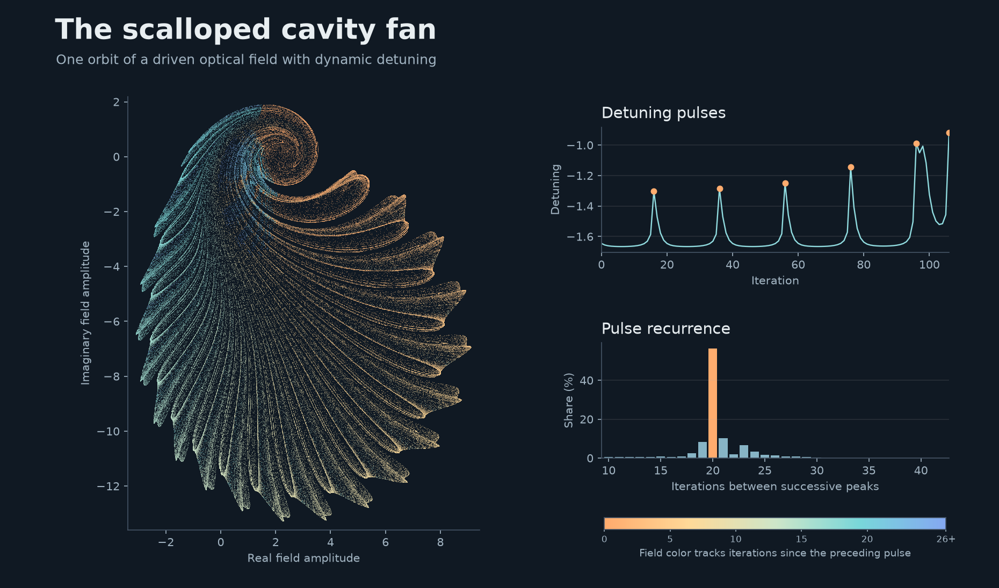
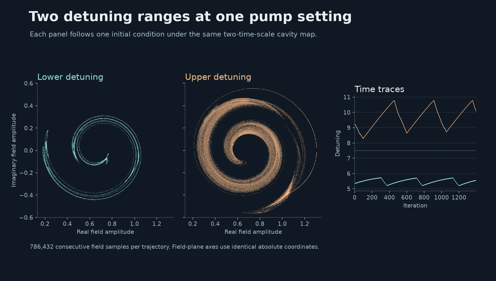

# Scalloped field amplitudes and coexisting cavity regimes

One optical field traces the scalloped fan below in 786,432 round trips (Case 45941). Color shows the time since the last detuning pulse. In Case 86780, changing only the initial state selects a thin or thick spiral. The two observed regimes stay separated throughout eight long runs. Interval arithmetic proves a finite segment of that separation.

[Cavity map](#the-cavity-map) · [Parameters and starts](#cases-and-evidence) · [Scalloped fan](#scalloped-fan) · [Two spirals](#two-spirals-at-one-setting) · [Selection](#selection-and-replication) · [Reproduce](#reproduction)



<!-- drawing-date -->
*Drawn: **2026-11-22**.*
<!-- /drawing-date -->

## The cavity map

Each round trip damps and rotates the complex field $`E=x+iy`$, then adds a constant pump. Its phase shift depends on the current intensity response $`f`$ and a relaxing detuning $`T`$. All quantities are dimensionless.

```math
\begin{aligned}
I&=x^2+y^2,& f&=I/(1+I),&\phi&=\delta+kf+T,\\
x'&=P+a(x\cos\phi-y\sin\phi),&
y'&=a(x\sin\phi+y\cos\phi),&
T'&=(1-h)T+hgf .
\end{aligned}
```

Here $`P`$ is the pump, $`a`$ the field retention, $`\delta`$ the static detuning, $`k`$ the instantaneous shift, $`g`$ the memory gain and $`h`$ the relaxation fraction. The model combines instantaneous and delayed saturation in an Ikeda-type optical ring cavity. The parameter sets are numerical examples. [Ikeda (1979)](https://doi.org/10.1016/0030-4018(79)90090-7) · [Ikeda, Daido and Akimoto (1980)](https://doi.org/10.1103/PhysRevLett.45.709) · [Ikeda and Akimoto (1982)](https://doi.org/10.1103/PhysRevLett.48.617)

For $`0<a,h<1`$, the triangle inequality gives $`|E_n|\le a^n|E_0|+P(1-a^n)/(1-a)`$. The detuning's distance to the interval with endpoints $`0,g`$ decays at least as $`(1-h)^n`$. The map is a diffeomorphism. From $`E',T'`$ recover $`I=|E'-P|^2/a^2`$, then $`T=(T'-hgf)/(1-h)`$ and $`E=(E'-P)e^{-i(\delta+kf+T)}/a`$. Before the final translation, the transformation in squared radius, angle and detuning has constant Jacobian determinant $`a^2(1-h)`$. Continuity extends the formula to the origin.

## Cases and evidence

| Case and orbit | $`P`$ | $`a`$ | $`\delta`$ | $`k`$ | $`g`$ | $`h`$ | Mean Lyapunov spectrum per iteration |
|---|---:|---:|---:|---:|---:|---:|---|
| 45941, scalloped fan | 2.20306635 | .96300721 | −1.33054030 | 9.05175877 | −1.67616093 | .69594193 | (.09617, −.15696, −1.20514) |
| 86780, lower detuning | .68380272 | .47694415 | .64927274 | −17.94019890 | 19.38252068 | .00387439 | (.03432, −.37055, −1.14837) |
| 86780, upper detuning | .68380272 | .47694415 | .64927274 | −17.94019890 | 19.38252068 | .00387439 | (.21472, −.42000, −1.27932) |
| 56729, alternating components | 2.07087350 | .92762107 | 2.81838250 | 3.30097151 | −17.03116226 | .01012690 | (.05810, .03249, −.25103) |

Case numbers index the Sobol sequence from zero. Each orbit starts at $`(.173,-.341,.271)`$ except the upper branch of Case 86780, which starts at $`(.7124512033204118,-.4674104975241916,9.823930680698279)`$. The spectra use twelve windows of 262,144 steps after discarding the first 131,072. The archive retains the final 786,432 consecutive Cartesian states. An independent complex-exponential implementation uses $`f=1-1/(1+I)`$. [Exact parameters, starts and hashes](manifest.json)

### Scalloped fan

**Case 45941.** Of 38,492 detuning-pulse intervals, 21,734 lasted exactly twenty steps (56.46%). The median was 20, with 1st and 99th percentiles of 11 and 29. The peak detector used 0.10 prominence and ten-step minimum spacing. Moving the height cutoff from −1.55 to −1.45 preserved the counts.

The leading exponent ranged from .09471 to .09789 across twelve windows. The exponent sums agreed with the analytic log determinant within $`4.5\times10^{-14}`$. All sixteen additional starts gave similar orbit statistics. Pairwise histogram distances between the two implementations were smaller than between the two halves of the original orbit. Freezing detuning at its mean still gave positive growth. [Pulse, spectrum and start checks](case-45941.json)

### Two spirals at one setting

**Case 86780.** At low detuning the field nearly returns to its previous location every third step (median chord lengths .546 for one step and .0017 for three). At high detuning the corresponding medians are .0030 and .0085. The low branch produced 1,828 detuning peaks a median 424 steps apart. Freezing detuning at its low-branch mean gave a negative leading exponent. [Lower branch](case-86780.json) · [Upper branch and starts](case-86780-basins.json)



<!-- drawing-date -->
*Drawn: **2026-11-22**.*
<!-- /drawing-date -->

**Numerical persistence.** Nine initial fields crossed with 257 initial detunings gave 2,313 starts. During 8,192 post-transient steps, 822 stayed below $`T=7.5`$ and 1,491 above. These counts describe the sampled grid. Eight independent runs totaling 134,217,728 steps left the interval (6.10748, 7.95709) empty. [Starts and long-run controls](case-86780-basins.json)

**Certified separation.** For two exact starting points, Arb encloses each iterate from 2,048 through 8,192 in $`5\lt T\lt 6.3`$ or $`7.6\lt T\lt 11`$, respectively. Every coordinate-ball radius stayed below $`2^{-64}`$. Inputs are the exact binary values of the archived floats. Separation for all future time remains open. [Lower interval calculation, 24,576 bits](arb-lower.json) · [Upper interval calculation, 40,960 bits](arb-upper.json)

There is a unique fixed point, with $`6.88810<T<6.88811`$ in the observed gap. Its intensity is the positive root of

```math
I\left[1+a^2-2a\cos\left(\delta+(k+g)\frac{I}{1+I}\right)\right]=P^2 .
```

For these parameters, $`k+g>0`$ and $`0<\delta<\delta+k+g<\pi`$. The left side is strictly increasing from zero to infinity. Arb bisection and characteristic-polynomial sign changes bracket its three multipliers in $`(.05780,.05783)`$, $`(1.00159,1.00162)`$ and $`(3.91303,3.91306)`$. Thus the equilibrium has one stable direction and two unstable directions. Its stable manifold has codimension two. The calculation does not identify a basin-dividing surface. [Equilibrium certificate](case-86780-equilibrium.json)

### Alternating lobes

**Case 56729.** The real field alternated between $`[-.456,.321]`$ and $`[1.890,2.805]`$ at every stored step (outward-rounded bounds). The second exponent ranged from .03141 to .03330 across the long windows. Four of sixteen additional starts reached this two-positive-exponent regime. The other twelve had negative leading exponents. [Spectra and starts](case-56729.json) · [Parity ranges](manifest.json)

## Selection and replication

A scrambled Sobol sequence supplied 131,072 six-parameter settings. The first GTX 1080 screen used a 3,584-step burn-in and four 512-step windows. Of 54,340 cases with leading growth above .012 throughout, 51,563 also passed the .0003 covariance eigenvalue-fraction cutoff. Farthest-point sampling selected 2,400 by growth, covariance, detuning and fluctuation statistics.

The second GPU run discarded 24,576 steps and used four 4,096-step windows. It retained 2,308 cases with leading rate above .01 throughout. A double-precision check found 165 of the 2,400 with a second rate above .01 in every window. Geometry, return lags and occupancy narrowed the visual comparison to 144, then 18 for longer portraits and three for the tests above. [Search and validation code](../../../research/wow_search_20261122/orbit) · [Selection counts](manifest.json)

## Reproduction

Run from the repository root. Set `$cache` to an external writable directory. Rebuilding orbits from the checked-in records requires NumPy, Numba and SciPy. The full scan also requires PyOpenCL and Pillow, the plots use Matplotlib, and the interval checks use python-flint 0.9.0.

```powershell
$code = 'research/wow_search_20261122/orbit'
$data = 'results/wow_search_20261122/orbit'
$cache = 'D:/Codex/chaos-attractor-cache/wow-search-20261122/orbit'
foreach ($case in @(45941, 86780, 56729)) {
    python "$code/validate.py" --record "$data/case-$case.json" --cache $cache --cloud-only
}
python "$code/basins.py" --record "$data/case-86780.json" --cache $cache --out $data --cloud-only
python "$code/plot.py" --cloud "$cache/case-45941.npz" --out "$data/scalloped-cavity-fan.png"
python "$code/plot_basins.py" --cache $cache --out "$data/coexisting-cavity-regimes.png"
python "$code/finite_enclosure.py" --record "$data/case-86780.json" --branch lower --bits 24576 --out "$data/arb-lower.json"
python "$code/finite_enclosure.py" --record "$data/case-86780.json" --branch upper --bits 40960 --out "$data/arb-upper.json"
python "$code/fixed_point.py" --record "$data/case-86780.json" --out "$data/case-86780-equilibrium.json"
```

To rerun the search, execute `survey.py`, `morphology.py` and `spectra.py` with the same `--cache`. Pass the eighteen IDs in `manifest.json` to `inspect_survivors.py`. Omitting `--cloud-only` repeats the numerical controls. Set `--out` for their records, then run `summarize.py` with `--cache` and `--out` to rebuild the manifest.

Each NPZ contains chronological float32 `points` (real field, imaginary field, detuning), float64 parameters and a float64 starting state. Reproduction was bitwise on the original Windows stack. Across platforms, compare orbit statistics after trajectories diverge.
